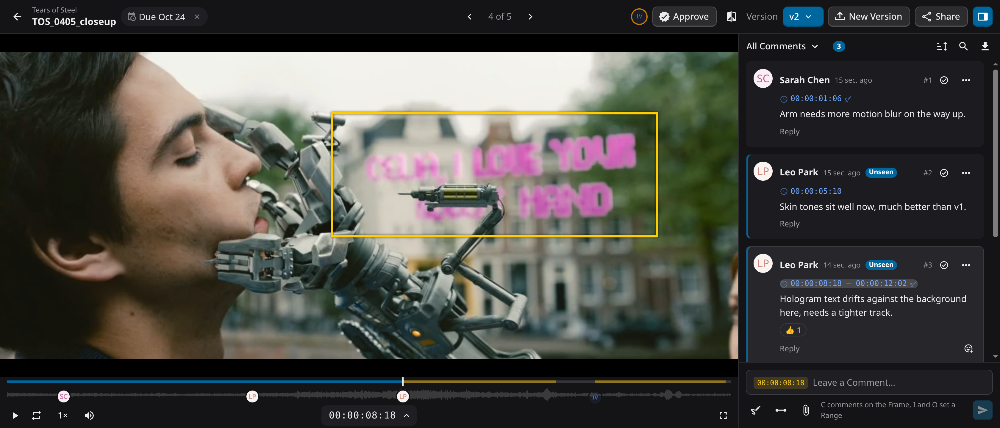

# Deliver

**Multimedia review tool for creatives.** 100% free, feature-complete alternative to Frame.io, but aspiring for more.

> [!NOTE]
> Deliver is approaching v1.0 and will still have some bugs. Please help by [creating an issue](https://github.com/joshuabke/nextcloud-deliver/issues/new) for everything you find!

## What it does

- 📂 **Review in place** from the Files sidebar, or a whole folder as a Project. Nothing is copied or moved.
- 🎯 **Comments on the Frame** or a Range, with Drawings, Replies, Reactions, Mentions and Attachments
- 🗂️ **Versions** stack by name (`…_v1`, `…_v2`) and compare side by side or under a wipe
- ✅ **Sign-off** with Approvals, Due Dates and reminders
- 🔗 **Clients without accounts** on Project Links: password, expiry, Watermark, downloads, and who watched what
- ⬆️ **Uploads in Deliver** that resume after an interruption, run in the background and show the processing until it is done
- 🎬 **Back into the edit** export comments as markers for:
  - Video: DaVinci Resolve (EDL), Premiere Pro (FCP7 XML), Final Cut Pro (FCPXML), CSV
  - Audio: WAV markers, MIDI, REAPER regions, Ableton Live Set
- 🎞️ **Supported files**
  - Video: MP4 and MOV (H.264), WebM
  - Audio: WAV, FLAC, MP3, AAC, Ogg
  - Images: JPEG, PNG, WebP, GIF, AVIF
  - Everything else (ProRes, H.265, MXF, AVI …) needs ffmpeg
- 🌊 **Waveforms, thumbnails and scrubbing** by hovering over a video
- 📱 **Fully mobile ready**: use it as a web app on iOS and Android, and get notifications through the official Nextcloud app
- ⚡ **With ffmpeg on the server**
  - Proxies, thumbnails and waveforms for every format ffmpeg reads
  - Hardware encoding: VAAPI, NVENC, VideoToolbox

More screenshots are on the [App Store page](https://apps.nextcloud.com/apps/deliver).

## Roadmap

- **1.0**: the 0.x pre-releases settle, with the bugs you report fixed
- **1.1 – Takes**: compare the Takes of a recording session on one timeline, jump between them at the same position and comment on the one that works
- **Ideas**: [captions (.srt)](https://github.com/joshuabke/nextcloud-deliver/issues/54), [Proxies uploaded by hand](https://github.com/joshuabke/nextcloud-deliver/issues/55) for servers without ffmpeg, [protecting files with Comments against silent overwrites](https://github.com/joshuabke/nextcloud-deliver/issues/13)

## Installation

Install **Deliver** from the Nextcloud App Store: *Apps → Multimedia → Deliver*. It needs Nextcloud 33 to 35 and PHP 8.2 or newer. How it fares on hosted Nextcloud is [below](#hosted-nextcloud).

Everything else is optional:

- **ffmpeg and ffprobe** on the server, for Proxies, Thumbnail Strips and hardware encoding (*With ffmpeg on the server* above). Shared hosting without them works for browser-native files.
- **The Movie preview provider**, so that lists show a still of each video instead of an icon.
- **[notify_push](https://github.com/nextcloud/notify_push)**, so that new Comments reach open Review views at once instead of within seconds.

The details are in [docs/admin.md](docs/admin.md); a Compose setup for a server of your own is in [deploy/](deploy/README.md).

## Hosted Nextcloud

Deliver runs without ffmpeg and without a shell, so a managed Nextcloud can run it. 
Here is a table of providers and when the info was verified. 
Everything marked with a ❓ has yet to be confirmed and is just assumed from their documentation.
Additions or corrections are welcome as issues or pull requests!

| Provider | Deliver in the app list | ffmpeg | Shell / `occ` | Verified |
| --- | --- | --- | --- | --- |
| Hetzner Storage Share | ✅ | ❌ (on the roadmap) | ❌ | 2026-10 |
| IONOS Managed Nextcloud | ❌ | ❌ | ❓ | - |
| hosting.de Managed Nextcloud | ❌ | ❌ | ❓ | - |
| The Good Cloud (Business, 25+ users) | ❓ | ❓ | ❓ | - |
| The Good Cloud (Family, Business) | 🟡* | ❓ | ❓ | - |
| Woelkli (own instance) | ❓ | ❓ | ❓ | - |
| Zaclys (Stratus, Alto, Cirrus) | ❓ | ❓ | ❓ | - |
| Webo (Admin) | ❓ | ❓ | ❓ | - |
| Cloud68 | ❓ | ❓ | ❓ | - |
| Stackhero | ❓ | ❓ | ❓ | - |
| wolkesicher.de | ❓ | ❓ | ❓ | - |
| Tab.digital | ❓ | ❓ | ❓ | - |
| Murena Workspace | ❌ | ❓ | ❌ | - |
| Framaspace | ❌ | ❓ | ❌ | - |
| MagentaCLOUD | ❌ | ❓ | ❌ | - |
| Own server ([deploy/](deploy/README.md)) | ✅ | ✅ | ✅ | 2026-10 |

\* The provider allows only apps it has approved; ask it to add Deliver.

## Documentation

- [Running Deliver](docs/admin.md): requirements, the derived-media pipeline, hardware encoders, live updates
- [Developing Deliver](docs/development.md): the dev instance, tests, packaging and releases
- [API](docs/api.md): the OCS API and the Reviewer's surface
- [App Store](docs/app-store.md): certificate, registration and publishing
- [Glossary](CONTEXT.md), [decisions](docs/adr/) and the [spec](docs/spec-v2.md)
- [Changelog](CHANGELOG.md)

## License

AGPL-3.0-or-later. The footage in the screenshots is from *Tears of Steel*, (CC) Blender Foundation | [mango.blender.org](https://mango.blender.org), CC BY 3.0.
